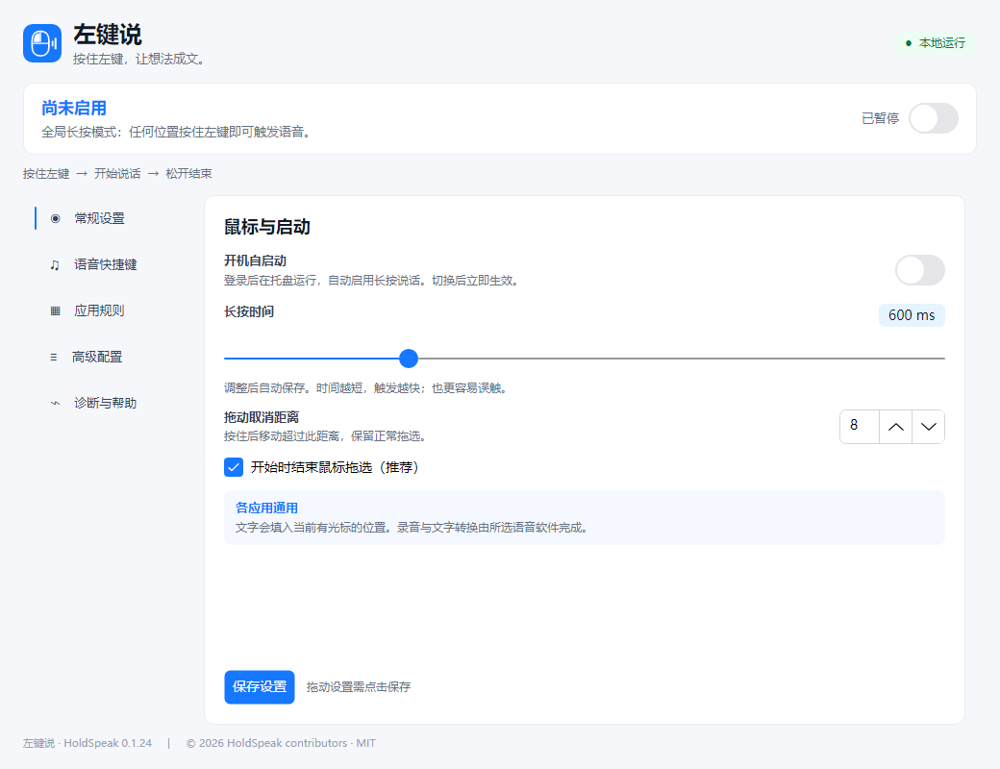
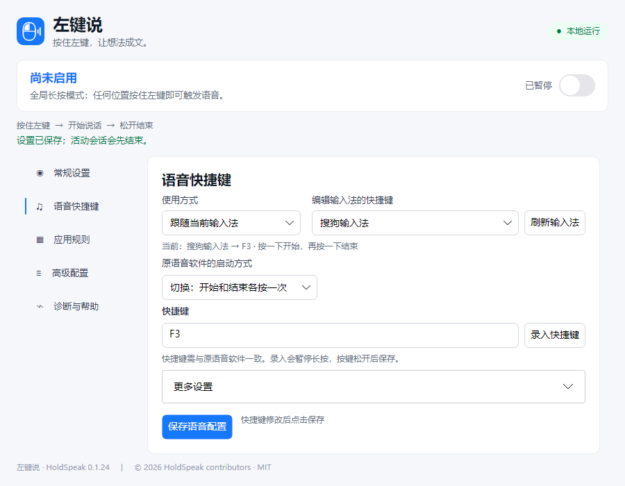
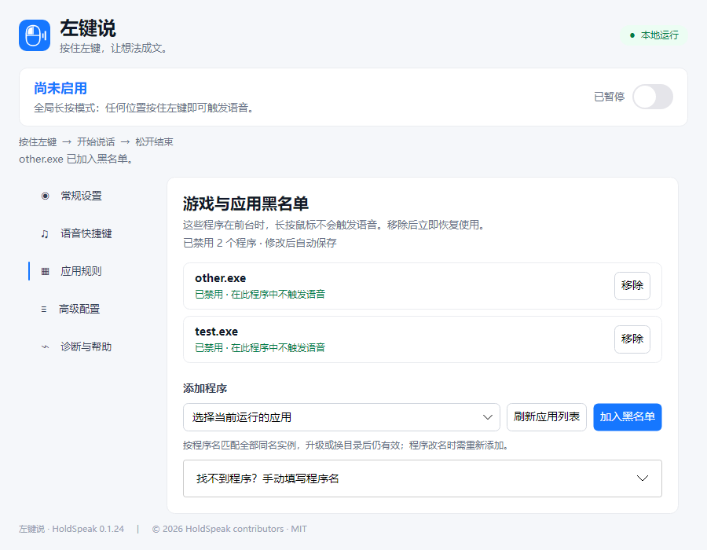

# HoldSpeak

English | [简体中文](README.md)

Hold the left mouse button to activate an existing voice-input application's shortcut; release it to stop. The voice software performs recognition and inserts the text at the current keyboard focus.

## Download and start

1. Download the Windows x64 portable ZIP from [Releases](https://github.com/wantosure-cmd/HoldSpeak/releases). Extract it and run `HoldSpeak.App.exe`.
2. Install and configure your voice-input software first. In **语音快捷键** (Voice shortcuts), choose a fixed shortcut or follow the active input method. Set the shortcut to match the voice software and save it.
3. Click where you want to type, hold the left mouse button and speak, then release to finish.
4. To avoid activation in a game, open **应用规则** (App rules), select the running game and add it to the blocklist. Remove entries directly from the list.
5. Closing the window hides the application in the system tray; use the tray menu to quit. Enable login startup in **常规设置** (General settings) if desired.

The current application interface is in Chinese; the screenshots below use example settings and application names.





## Shortcut modes

- **Fixed shortcut:** always use the selected voice profile, regardless of the current input method.
- **Follow input method:** use the shortcut assigned to the active input method. An unknown or unconfigured input method does not trigger a shortcut.

The Windows examples use Ctrl+Win held for WeType and F2 toggled for Sogou, as confirmed on the original test machine. Check and edit these settings to match your own voice software. The hold duration controls when HoldSpeak sends the shortcut, not the time taken for the voice application's window to appear.

## Compatibility and privacy

The default mode does not detect whether the pointer is over an editable field. An app on the blocklist is excluded when it is the active foreground application; the same Windows executable name matches all instances. If an update changes the executable name, add the new name separately.

HoldSpeak does not record audio, perform speech recognition, read text content, or send telemetry. Recognition and text insertion are handled by the selected voice software.

Windows is the currently tested platform. A macOS build and automated platform tests exist, but real-device permissions, login startup, voice recording, and insertion have not been validated. See [compatibility and validation](docs/compatibility.md).

## Build and contribute

Install the .NET 10 SDK and run:

```sh
dotnet run --project src/HoldSpeak.App/HoldSpeak.App.csproj
dotnet run --project tests/HoldSpeak.Core.Tests/HoldSpeak.Core.Tests.csproj
dotnet run --project tests/HoldSpeak.UI.Tests/HoldSpeak.UI.Tests.csproj
```

See [contribution guidelines](CONTRIBUTING.md), [architecture](docs/architecture.md), and [third-party notices](THIRD-PARTY-NOTICES.md).

## License and attribution

[MIT License](LICENSE). Redistribution of copies or substantial portions requires retaining the copyright and permission notice. See [attribution](ATTRIBUTION.md).