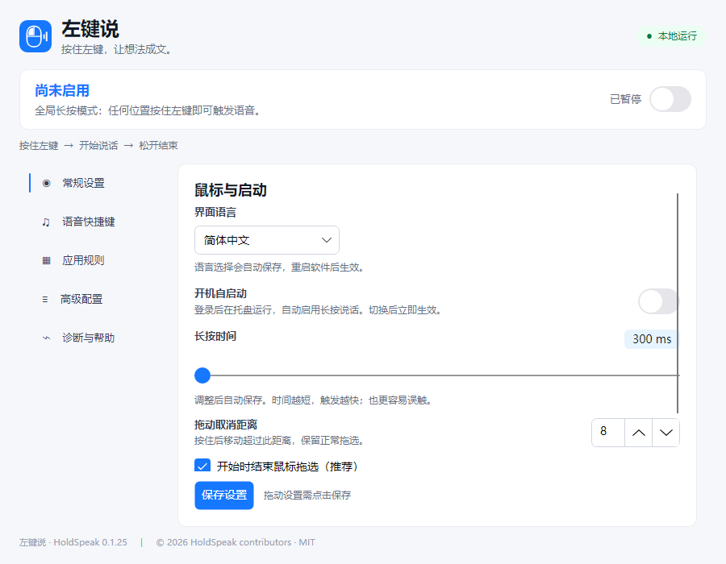
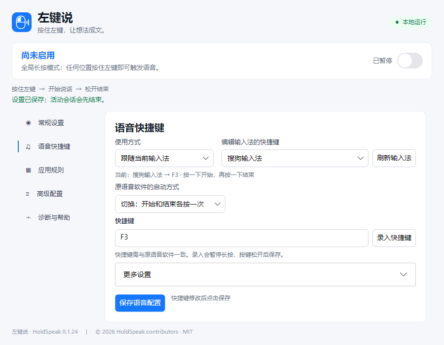
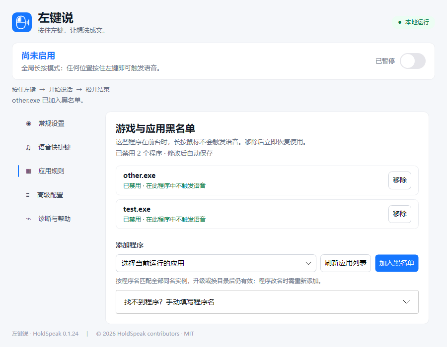

# 左键说 · HoldSpeak

简体中文 | [English](README.en.md)

## 功能说明

语音输入时，长按鼠标左键通常比反复寻找并按住 Ctrl、Alt 等组合快捷键更顺手。左键说把鼠标左键长按映射成已有语音输入软件的快捷键：按住说话，松开结束。你可以为不同输入法设置快捷键，也可以固定使用一套快捷键。

左键说负责发送快捷键；录音、语音识别和文字回填由你选择的语音输入软件完成。请先确认原软件支持快捷键，并在左键说中设置一致的启动方式和按键。

**可搭配的语音软件：**

- **微信输入法**：Windows 下已配置 Ctrl + Win 长按，用户曾确认可调用；新版仍需按实际环境复测。
- **[豆包输入法](https://srf.doubao.com/pc)**、**[Typeless](https://www.typeless.com/)**：可尝试在“语音快捷键”中设置与原软件一致的快捷键和启动方式，目前尚未完成实机验收。

快捷键需要是左键说支持的按键。当前不支持单独模拟 Fn；如果原软件使用 Fn，请先确认它能否改为支持的其他快捷键，再进行配置。
## 安装与使用

1. 在 [发布页面](https://github.com/wantosure-cmd/HoldSpeak/releases) 下载 Windows 便携版，解压后运行 `HoldSpeak.App.exe`。
2. 在“语音快捷键”选择固定使用一个快捷键，或跟随当前输入法；设置与原语音软件一致的快捷键并保存。
3. 点击输入位置，按住鼠标左键说话，松开结束。
4. 如游戏中误触发，可在“应用规则”选择游戏并加入黑名单；列表中的项目可以直接移除。
5. 关闭窗口会隐藏到系统托盘；需要完全退出时，使用托盘菜单。开机自启动可在“常规设置”中开启。

**界面语言：**支持简体中文、English、日本語和한국어。在“常规设置 → 界面语言”中选择，自动保存；从托盘菜单完全退出软件，再打开即可生效。界面语言与语音识别语言独立，识别语言请在原语音输入软件中设置。

下图为测试配置，显示的程序名和快捷键仅供演示。

[贡献指南](CONTRIBUTING.md) · [兼容性与验收](docs/compatibility.md) · [更新记录](CHANGELOG.md) · [MIT 许可证](LICENSE)
